<div align="center">

# Software Design: Developing Questions

### An Outcome-Based Education (OBE) Question Bank for Software Engineering


**Reference Book:** *Software Engineering* (10th Edition, Global Edition) by Ian Sommerville

</div>

---

| | |
|---|---|
| **Name** | `[Your Name]` |
| **Student ID** | `[Your ID]` |
| **Section / Batch** | `[Your Section / Batch]` |
| **Submitted to** | `[Teacher's Name]` |

---

## Table of Contents

- [1. Introduction](#1-introduction)
- [2. Assessment Overview](#2-assessment-overview)
- [3. Course Outcomes and Mapping](#3-course-outcomes-and-mapping)
- [4. Question Bank](#4-question-bank)
  - [Q1. Software Processes](#q1-software-processes)
  - [Q2. Agile Software Development](#q2-agile-software-development)
  - [Q3. Requirements Engineering](#q3-requirements-engineering)
  - [Q4. System Modeling with the UML](#q4-system-modeling-with-the-uml)
  - [Q5. Architectural Design](#q5-architectural-design)
  - [Q6. Object-Oriented Design and Implementation](#q6-object-oriented-design-and-implementation)
  - [Q7. Software Testing](#q7-software-testing)
  - [Q8. Software Evolution and Maintenance](#q8-software-evolution-and-maintenance)
  - [Q9. Quality Management](#q9-quality-management)
  - [Q10. Configuration Management](#q10-configuration-management)
- [5. References](#5-references)

---

## 1. Introduction

This repository contains an Outcome-Based Education (OBE) question set for the **Software Engineering** course. The questions were developed from Ian Sommerville's *Software Engineering* (10th Edition). Ten important topics were selected from the book, covering the whole software life cycle: processes, requirements, modeling, design, testing, evolution, quality and configuration management.

Each question is written using **Bloom's Taxonomy** at the **Knowledge** and **Understanding** levels (Cognitive domain, BNQF standard) and is mapped to a Course Outcome (CO). Every answer is based only on the content of the book, written in simple language, and supported by diagrams. Where a diagram is based on a figure from the book, it is redrawn here in Mermaid so it displays directly on GitHub.

> [!NOTE]
> All diagrams are written in [Mermaid](https://mermaid.js.org/), which GitHub renders automatically. UML diagrams (use case, sequence, class and state diagrams) are redrawn from the book's examples and simplified slightly to fit Mermaid notation.

---

## 2. Assessment Overview

| Item | Details |
|---|---|
| **Total marks** | 40 |
| **Duration** | 1 hour |
| **Number of questions** | 10 (4 marks each) |
| **Approach** | Outcome-Based Education (OBE) |
| **Taxonomy** | Bloom's Taxonomy |
| **Domain** | Cognitive (BNQF standard) |
| **Levels used** | Knowledge (Remember) and Understanding |

**Structure of each question**

| Part | Bloom's Level | Marks |
|---|---|---|
| (a) | Knowledge | 2 |
| (b) | Understanding | 2 |
| **Total per question** | | **4** |

**Marks by Bloom's level**

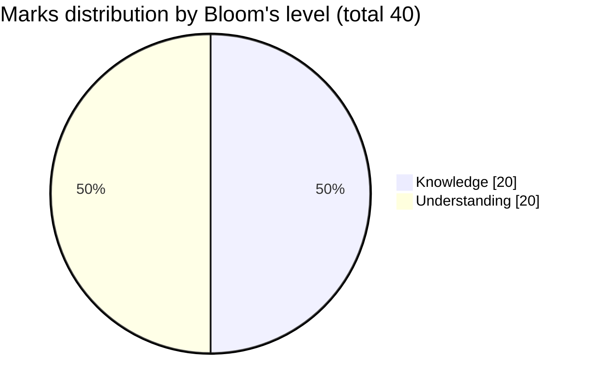

---

## 3. Course Outcomes and Mapping

<!-- If your course outline has official CO statements, replace the wording below with them. -->

| CO | Course Outcome | Questions |
|---|---|---|
| **CO1** | Explain software process models and agile development methods. | Q1, Q2 |
| **CO2** | Describe how requirements are developed and how systems are modeled using the UML. | Q3, Q4 |
| **CO3** | Explain architectural and object-oriented design, including patterns. | Q5, Q6 |
| **CO4** | Explain software testing approaches and software evolution and maintenance. | Q7, Q8 |
| **CO5** | Describe software quality management and configuration management. | Q9, Q10 |

**Question to CO mapping**

| Q | Topic | Book Chapter | CO | Bloom's Level | Marks |
|---|---|---|---|---|---|
| Q1 | Software Processes | Chapter 2 | CO1 | Knowledge, Understanding | 2 + 2 |
| Q2 | Agile Software Development | Chapter 3 | CO1 | Knowledge, Understanding | 2 + 2 |
| Q3 | Requirements Engineering | Chapter 4 | CO2 | Knowledge, Understanding | 2 + 2 |
| Q4 | System Modeling with the UML | Chapter 5 | CO2 | Knowledge, Understanding | 2 + 2 |
| Q5 | Architectural Design | Chapter 6 | CO3 | Knowledge, Understanding | 2 + 2 |
| Q6 | Object-Oriented Design and Implementation | Chapter 7 | CO3 | Knowledge, Understanding | 2 + 2 |
| Q7 | Software Testing | Chapter 8 | CO4 | Knowledge, Understanding | 2 + 2 |
| Q8 | Software Evolution and Maintenance | Chapter 9 | CO4 | Knowledge, Understanding | 2 + 2 |
| Q9 | Quality Management | Chapter 24 | CO5 | Knowledge, Understanding | 2 + 2 |
| Q10 | Configuration Management | Chapter 25 | CO5 | Knowledge, Understanding | 2 + 2 |
| | | | | **Total** | **40** |

---

## 4. Question Bank

---

## Q1. Software Processes

| CO | Bloom's Level | Marks | Source |
|---|---|---|---|
| CO1 | Knowledge, Understanding | 4 | Chapter 2 |

### Question

**(a)** *(Knowledge, 2 marks)* What is a software process? Name the four fundamental process activities and the three generic software process models.

**(b)** *(Understanding, 2 marks)* Explain the waterfall model, incremental development, and integration and configuration. Compare their strengths and weaknesses.

### Answer

#### (a) Software process and its activities

A **software process** is a set of related activities that leads to the production of a software system. No single process suits every kind of software. The process a company uses depends on the type of software, the customer's requirements, and the skills of the developers.

Every software process includes, in some form, these **four fundamental activities**:

1. **Software specification:** defining the functionality of the software and the constraints on its operation.
2. **Software development:** producing the software that meets the specification.
3. **Software validation:** checking that the software does what the customer wants.
4. **Software evolution:** changing the software to meet changing customer needs.

The book describes three **generic process models**: the **waterfall model**, **incremental development**, and **integration and configuration**.

#### (b) Comparing the three process models

**1. Waterfall model**

The waterfall model is a *plan-driven* process. It shows the fundamental activities as separate phases that follow one another. Each phase normally ends with approved documents, and the next phase should not begin until the previous one is finished.

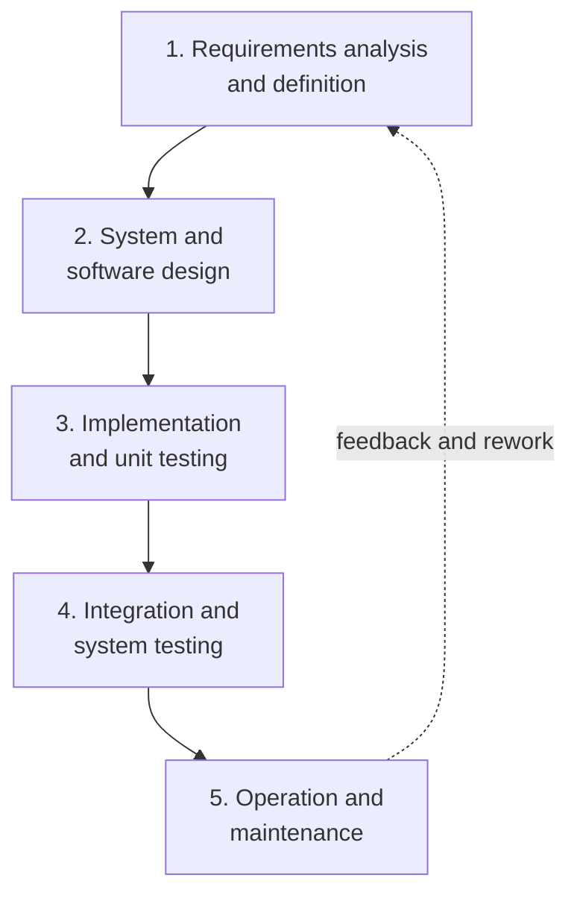
*Figure 1: The waterfall model.*

- **Strengths:** It works well when extensive analysis and documentation are needed before implementation starts.
- **Weaknesses:** In real projects the phases overlap and feed information back to each other. Changing earlier documents needs customer approval and delays the project. As a result, requirements may be frozen too early, so the system may not do what users want, or it may end up badly structured.
- **Suitable for:** embedded systems that interface with hardware, critical systems that need detailed safety and security analysis, and large systems developed by several partner companies.
- **Not suitable when:** requirements change quickly and the team can communicate informally.

**2. Incremental development**

Specification, development and validation are *interleaved*. An initial version is built, users give feedback, and the system is evolved through several versions. The most important functions are usually delivered first.

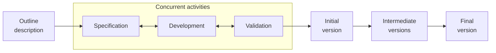
*Figure 2: Incremental development.*

- **Strengths:**
  1. The cost of implementing requirement changes is lower, because less analysis and documentation has to be redone.
  2. It is easier to get customer feedback, because customers can see working demonstrations.
  3. Useful software can be delivered and used early, even if not all functions are ready.
- **Weaknesses:**
  1. The process is not very visible to managers, because it is not cost-effective to document every version.
  2. The system structure tends to degrade as new increments are added, so regular *refactoring* is needed.
- **Suitable for:** most business systems and software products where requirements are likely to change. It is harder to use for large, complex, long-lifetime systems, which need a stable architecture planned in advance.

**3. Integration and configuration**

This approach is based on *reuse*. The system is built by configuring and integrating existing components or systems. Three kinds of components are commonly reused: stand-alone application systems configured for a specific environment, collections of objects built as a package for a component framework, and web services.

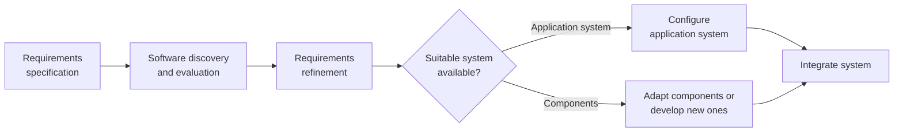
*Figure 3: Integration and configuration (reuse-oriented) process.*

- **Strengths:** There is less software to develop, so cost and risk are reduced, and delivery is usually faster.
- **Weaknesses:** Compromises on requirements are unavoidable, so the system may not fully meet users' real needs. The organization also loses some control over how reused components evolve, because new versions are not under its control.

**Summary table**

| Model | Main Idea | Best Suited For | Main Limitation |
|---|---|---|---|
| Waterfall | Separate, sequential phases | Embedded, critical and large multi-company systems | Hard to handle change |
| Incremental | Build and refine in versions | Business systems and products with changing requirements | Structure may degrade; low visibility |
| Integration and configuration | Reuse existing components | Systems where suitable components exist | Requirement compromises; less control |

**Conclusion:** No process model is right for every project. Most real processes are based on one general model but borrow features from the others. For large systems it makes sense to combine them: the architecture needs the essential requirements first, so it cannot be developed incrementally, while parts that are hard to specify in advance can be developed incrementally.

[Back to top](#table-of-contents)

---

## Q2. Agile Software Development

| CO | Bloom's Level | Marks | Source |
|---|---|---|---|
| CO1 | Knowledge, Understanding | 4 | Chapter 3 |

### Question

**(a)** *(Knowledge, 2 marks)* Why did agile methods emerge? State the characteristics and principles of agile development.

**(b)** *(Understanding, 2 marks)* Explain how Scrum organizes an agile project, including its roles, the sprint cycle and its benefits.

### Answer

#### (a) Agile methods: need, characteristics and principles

Modern businesses work in a fast-changing environment, so rapid development and delivery is often the most important requirement. It is almost impossible to produce a complete, stable set of requirements up front. Plan-driven processes that fully specify the system first are slow, and by the time the software is ready, the original need may have changed. Agile methods (such as Extreme Programming, Scrum and DSDM) became popular from the late 1990s to deliver useful software quickly.

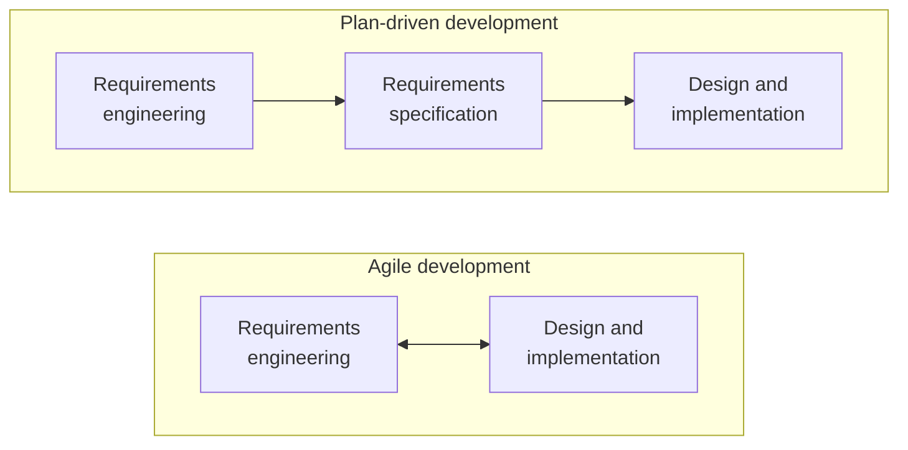
*Figure 4: Plan-driven development separates the activities into stages. Agile development interleaves them.*

**Common characteristics of agile methods:**

1. Specification, design and implementation are *interleaved*. There is no detailed specification, and design documentation is kept to a minimum.
2. The system is developed in a series of small increments. Users and other stakeholders take part in specifying and evaluating each one, and new releases are typically produced every two or three weeks.
3. Extensive tool support is used, such as automated testing tools, configuration management tools and tools for building user interfaces.

**Principles of agile methods:**

| Principle | Meaning |
|---|---|
| Customer involvement | Customers are closely involved throughout. They provide and prioritize requirements and evaluate each iteration. |
| Embrace change | Expect requirements to change and design the system to accommodate this. |
| Incremental delivery | The software is built in increments, and the customer decides which requirements go into each one. |
| Maintain simplicity | Keep both the software and the development process as simple as possible. |
| People, not process | Recognize and use the skills of the team and let them choose their own ways of working. |

The agile manifesto expresses the same thinking: it values individuals and interactions over processes and tools, working software over comprehensive documentation, customer collaboration over contract negotiation, and responding to change over following a plan.

**Where agile works best:** Agile methods have been especially successful for (1) product development, where a company builds a small or medium-sized product for sale, and (2) custom systems developed inside an organization, where the customer is committed to being involved and few outside stakeholders or regulations apply.

**Extreme Programming (XP)** is one of the best-known agile approaches. Requirements are written as *user stories*. Developers work in pairs, write tests before the code, refactor continuously, integrate code often, and make small, frequent releases.

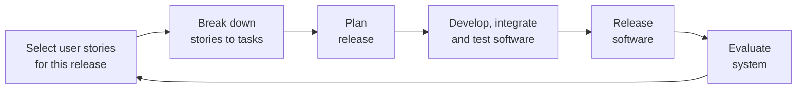
*Figure 5: The XP release cycle.*

#### (b) Scrum

**Scrum** is an agile method that provides a framework for organizing agile projects and gives managers some visibility of progress. It does not require specific programming practices, so it fits easily with a company's existing practices. It is the most widely used agile method.

**Main Scrum terms and roles:**

| Term | Meaning |
|---|---|
| **Product backlog** | The list of "to do" items for the team, such as features, requirements, user stories or supporting tasks. |
| **Product Owner** | Identifies and prioritizes backlog items and keeps checking that the project meets business needs. |
| **ScrumMaster** | Makes sure the Scrum process is followed, guides the team, and protects it from outside interference. |
| **Development team** | A self-organizing group of no more than seven developers. |
| **Sprint** | One development iteration, usually 2 to 4 weeks long. |
| **Sprint backlog** | The work chosen for one particular sprint. |
| **Daily Scrum** | A short daily meeting to review progress and re-prioritize work. |
| **Velocity** | An estimate of how much backlog work a team can complete in one sprint. |
| **Potentially shippable increment** | The finished software produced by a sprint. |

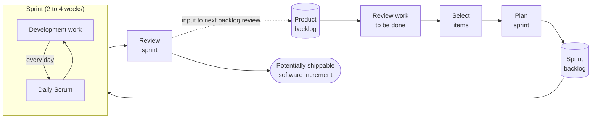
*Figure 6: The Scrum cycle.*

**The sprint cycle:**

1. The Product Owner prioritizes the product backlog at the start of each cycle.
2. The whole team selects the highest-priority items it believes it can finish and estimates the effort, using the velocity from earlier sprints. This creates the **sprint backlog**.
3. The sprint begins and the team organizes itself, deciding who works on what.
4. During the sprint, short daily Scrums let everyone share progress, raise problems and state plans for the next day. A Scrum board helps everyone see the status of the work.
5. Sprints are never extended. Unfinished items go back to the product backlog.
6. At the end of the sprint, a review meeting is held. The team reflects on how to improve its way of working and gives input for the next backlog review.

**Benefits of Scrum:**

1. The product is split into small pieces that stakeholders can understand.
2. Unstable requirements do not hold up progress.
3. The whole team can see everything, which improves communication and morale.
4. Customers receive increments on time and give feedback, so there are no last-minute surprises.
5. Trust grows between customers and developers, creating a positive culture where everyone expects the project to succeed.

[Back to top](#table-of-contents)

---

## Q3. Requirements Engineering

| CO | Bloom's Level | Marks | Source |
|---|---|---|---|
| CO2 | Knowledge, Understanding | 4 | Chapter 4 |

### Question

**(a)** *(Knowledge, 2 marks)* Define *requirements* and *requirements engineering*. Distinguish between user and system requirements, and between functional and non-functional requirements.

**(b)** *(Understanding, 2 marks)* Explain the main activities of the requirements engineering process and explain why requirements change.

### Answer

#### (a) Key concepts

The **requirements** for a system describe the services the system should provide and the constraints on its operation. **Requirements engineering (RE)** is the process of finding out, analyzing, documenting and checking these services and constraints.

**User requirements vs. system requirements**

| | User Requirements | System Requirements |
|---|---|---|
| Description | Statements, in natural language plus diagrams, of the services the system should provide and the constraints it must follow | More detailed descriptions of the system's functions, services and operational constraints |
| Level of detail | High-level and abstract | Detailed; they define exactly what is to be implemented |
| Typical readers | Client managers, end-users | End-users, client engineers, system architects, software developers |

*Example (Mentcare system):* The user requirement "generate monthly management reports showing the cost of drugs prescribed by each clinic" is expanded into several system requirements. These cover when the report is generated, what it contains for each clinic, and who is allowed to access it.

**Functional vs. non-functional requirements**

- **Functional requirements** describe the services the system should provide, how it should react to particular inputs, and how it should behave in particular situations. Sometimes they also state what the system should *not* do.
- **Non-functional requirements** are constraints on the services or functions of the system, such as timing constraints, constraints on the development process, and constraints from standards. They often apply to the system as a whole.

Non-functional requirements are often more critical than individual functional requirements. Users can work around a missing function, but if a non-functional requirement is not met, the whole system may become unusable.

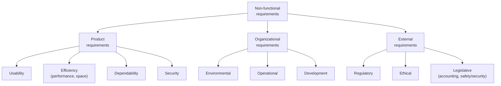
*Figure 7: Types of non-functional requirement.*

| Type | Meaning | Example (Mentcare) |
|---|---|---|
| **Product** | Constrain the runtime behavior of the software (performance, reliability, security, usability) | The system must be available during working hours, with limited downtime per day. |
| **Organizational** | Come from the policies and procedures of the customer's and developer's organizations | Users must identify themselves using their health authority identity card. |
| **External** | Come from factors outside the system and its development process | The system must follow a national patient privacy standard. |

Non-functional requirements should be written so they can be tested. A vague goal such as "the system should be easy to use" can be rewritten as a measurable one, such as staff being able to use all functions after two hours of training, with a limit on the average number of errors.

#### (b) The requirements engineering process

RE has three key activities: discovering requirements by interacting with stakeholders (**elicitation and analysis**), converting them into a standard form (**specification**), and checking that they define the system the customer really wants (**validation**). In practice these activities are *interleaved* and repeated iteratively, not carried out strictly one after another.

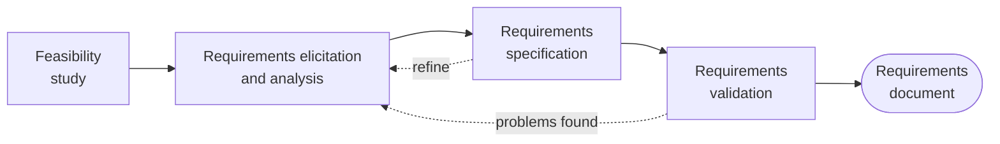
*Figure 8: The requirements engineering process.*

**1. Requirements elicitation and analysis**

The aim is to understand the work stakeholders do and how a new system can support it. This is difficult because stakeholders often do not know exactly what they want, express needs in their own terms, have conflicting requirements, may be influenced by organizational politics, and work in a changing business environment.

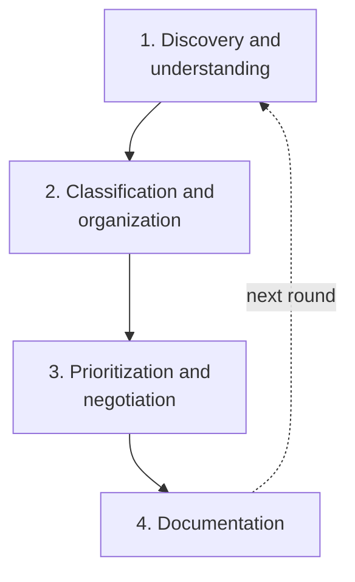
*Figure 9: The elicitation and analysis cycle.*

**2. Requirements specification**

The gathered requirements are written down in a standard form at two levels of detail: user requirements for customers and managers, and more detailed system requirements for the people who will build the system.

**3. Requirements validation**

Validation checks that the requirements describe what the customer really wants. It is very important because fixing a requirements error later costs far more than fixing a design or coding error. The main checks are:

- **Validity:** do the requirements reflect the real needs of users?
- **Consistency:** do any requirements conflict with each other?
- **Completeness:** are all functions and constraints included?
- **Realism:** can the requirements be implemented within the budget and schedule?
- **Verifiability:** can tests be written to show that each requirement is met?

Useful validation techniques are **requirements reviews**, **prototyping** and **test-case generation**.

**Why do requirements change?**

1. Large systems often address "wicked" problems that cannot be fully defined, so stakeholders' understanding grows during development.
2. The business and technical environment changes after installation: new hardware appears, business priorities shift, and new laws are introduced.
3. The people who pay for the system are rarely the same people who use it, so their needs can conflict.
4. Large systems have many stakeholders with different, sometimes contradictory, priorities, so requirements may need to be re-prioritized later.

Because of this, requirements must be managed carefully, which means keeping track of individual requirements and the links between dependent ones.

[Back to top](#table-of-contents)

---

## Q4. System Modeling with the UML

| CO | Bloom's Level | Marks | Source |
|---|---|---|---|
| CO2 | Knowledge, Understanding | 4 | Chapter 5 |

### Question

**(a)** *(Knowledge, 2 marks)* What is a system model? State the four modeling perspectives and name the five UML diagram types emphasized in the book.

**(b)** *(Understanding, 2 marks)* Explain use case, sequence, class and state diagrams using the Mentcare and microwave oven examples. Draw each diagram.

### Answer

#### (a) System models, perspectives and UML diagrams

**System modeling** is the process of developing abstract models of a system, where each model presents a different view or perspective of it. Today it usually means representing a system with graphical notations based on the **Unified Modeling Language (UML)**. A model is an *abstraction*: it deliberately leaves out detail so the system is easier to understand.

**Models are used to:**

1. Stimulate and focus discussion about an existing or proposed system.
2. Document an existing system (the models must then be correct).
3. Give a detailed system description from which an implementation can be generated (the models must then be complete and correct).

**Four perspectives:**

| Perspective | What it Models |
|---|---|
| **External** | The context or environment of the system |
| **Interaction** | Interactions between the system and its environment, or between its components |
| **Structural** | The organization of the system or the structure of the data it processes |
| **Behavioral** | The dynamic behavior of the system and how it responds to events |

**Five UML diagram types** (the UML has 13 in total):

| Diagram | Purpose |
|---|---|
| **Activity diagram** | Shows the activities involved in a process or in data processing |
| **Use case diagram** | Shows interactions between a system and its environment |
| **Sequence diagram** | Shows interactions between actors and the system, and between system components |
| **Class diagram** | Shows the object classes and the associations between them |
| **State diagram** | Shows how the system reacts to internal and external events |

#### (b) Explaining the main UML diagrams

**1. Use case diagram (interaction model)**

A use case describes one discrete task that involves external interaction with the system. Actors (people or other systems) are drawn as stick figures and use cases as ellipses. Each use case also needs a more detailed description, for example in a table or a sequence diagram.

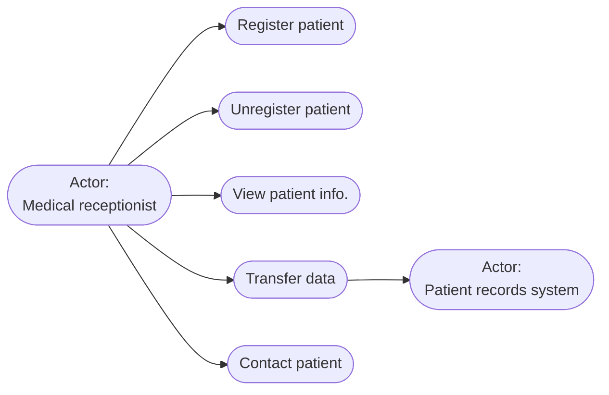
*Figure 10: Use cases involving the medical receptionist (Mentcare). Mermaid has no native use case diagram, so ovals and boxes are used.*

**2. Sequence diagram (interaction model)**

A sequence diagram shows the order of interactions during a use case. Objects and actors are listed along the top, time runs downwards, and arrows show calls and returns. The `alt` box shows alternatives chosen by a condition.

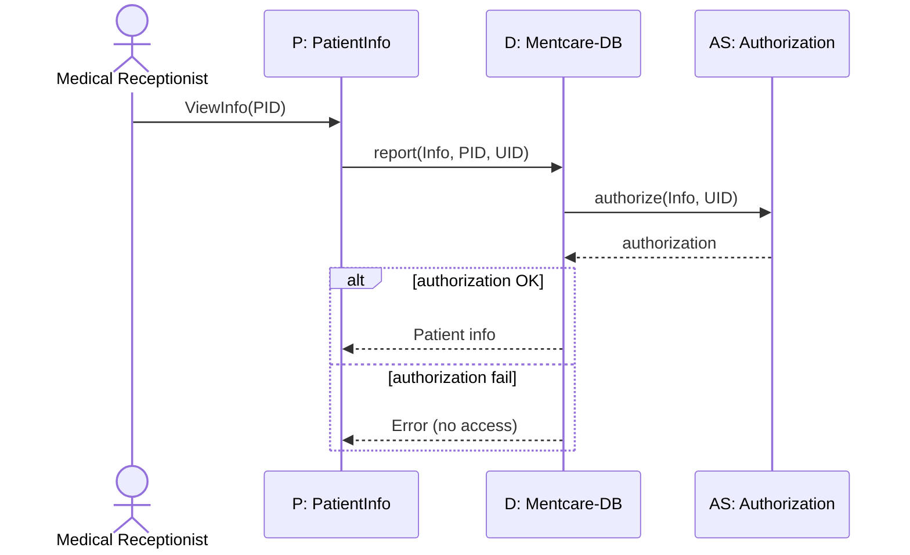
*Figure 11: Sequence diagram for "View patient information" (Mentcare).*

How to read it: the receptionist triggers `ViewInfo` on the PatientInfo form. The form asks the database for the data, supplying the user's identifier for a security check. The database checks with an authorization system. If authorized, the patient information is returned and displayed. Otherwise an error message is returned.

**3. Class diagram (structural model)**

A class diagram shows object classes and the associations between them. Associations carry *multiplicities*, such as `1` (exactly one) or `1..*` (one or more). A class box has three parts: name, attributes and operations. Two special relationships are shown below.

- **Aggregation:** one object (the whole) is made of other objects (the parts). A patient record is an aggregate of a patient and any number of consultations.
- **Generalization:** common attributes and operations are kept in a general class and inherited by subclasses. This keeps common information in one place, so changes are easier.

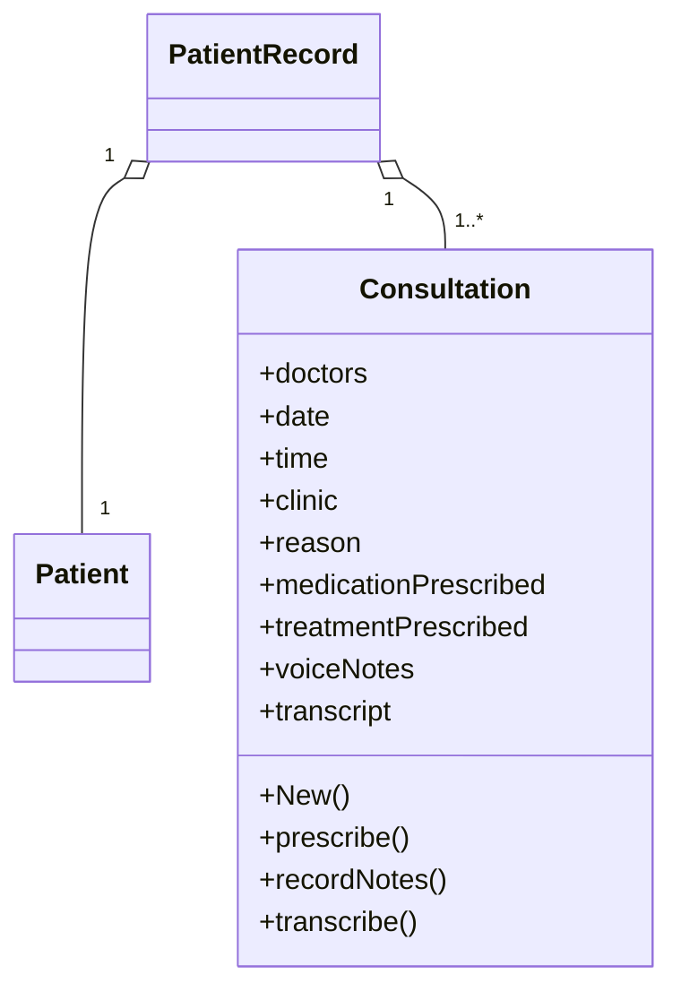
*Figure 12: Aggregation and the Consultation class (Mentcare).*

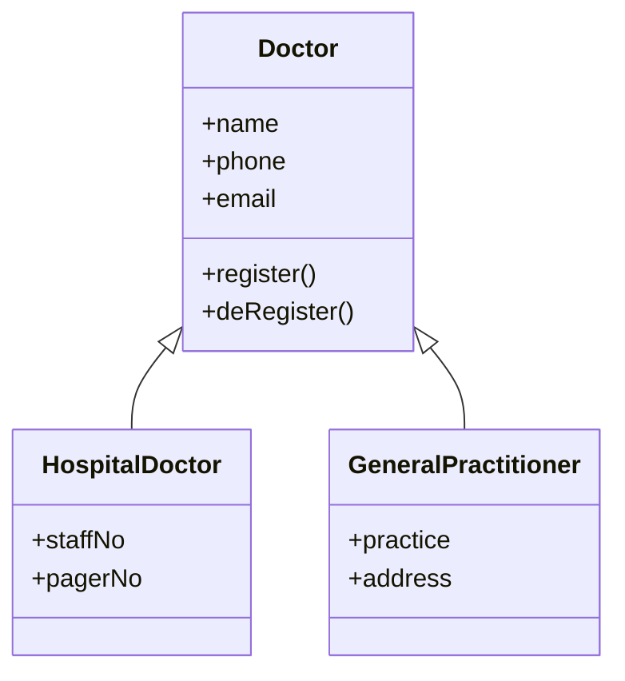
*Figure 13: Generalization hierarchy for doctors (Mentcare).*

**4. State diagram (behavioral model)**

State diagrams show how a system moves between a finite number of states when events (stimuli) occur. They are especially suitable for real-time systems. Rounded boxes are states and labeled arrows are the stimuli that cause transitions.

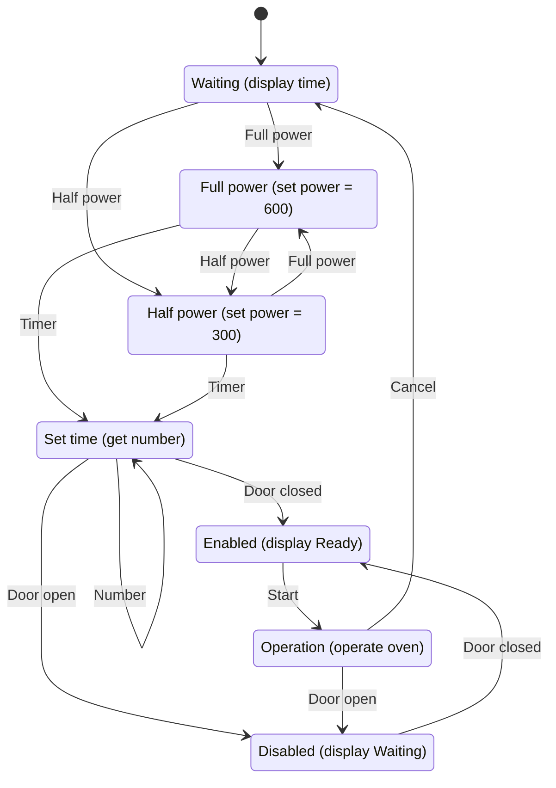
*Figure 14: State diagram of a simple microwave oven.*

The oven starts in the waiting state and responds to the full-power or half-power button. After the time is set, the Start button is enabled only if the door is closed. Cooking then runs for the chosen time. For safety, opening the door disables operation. The main limitation of state models is that the number of states grows quickly for large systems, so detail is hidden using *superstates*.

[Back to top](#table-of-contents)

---

## Q5. Architectural Design

| CO | Bloom's Level | Marks | Source |
|---|---|---|---|
| CO3 | Knowledge, Understanding | 4 | Chapter 6 |

### Question

**(a)** *(Knowledge, 2 marks)* What is software architecture and why is it important? List the architectural views used to describe a system.

**(b)** *(Understanding, 2 marks)* Explain how non-functional requirements influence architectural design. Describe the MVC, Layered, Repository and Client-Server patterns with diagrams.

### Answer

#### (a) Software architecture, its importance and views

A **software architecture** is a description of how a software system is organized. **Architectural design** is concerned with understanding how a system should be organized and designing its overall structure. The book notes that architectural design overlaps significantly with requirements engineering, because the main architectural components reflect the high-level features of the system.

**Why it matters:** Architecture strongly affects the performance, robustness, distributability and maintainability of a system. Individual components implement the functional requirements, but the architecture has the dominant effect on non-functional characteristics. Designing and documenting it explicitly has three advantages:

1. **Stakeholder communication:** it is a high-level view that different stakeholders can discuss.
2. **System analysis:** making the architecture explicit early forces analysis of whether the system can meet requirements such as performance, reliability and maintainability.
3. **Large-scale reuse:** the same architecture can often be reused in systems with similar requirements, for example in product lines.

**Architectural views:** One diagram can show only one perspective of a system, so several views are used. In the well-known 4+1 view model they are:

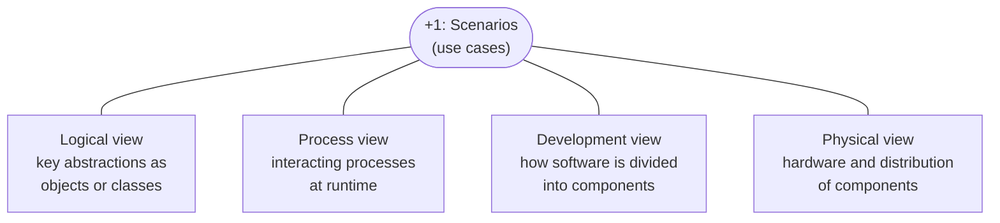
*Figure 15: The 4+1 view model of software architecture.*

The views are linked through common use cases or scenarios. A **conceptual view** is another abstract view that is almost always developed during design to explain the architecture to stakeholders.

#### (b) Non-functional requirements and architectural patterns

**How non-functional requirements shape the architecture**

| Requirement | Architectural Approach |
|---|---|
| **Performance** | Keep critical operations in a small number of relatively large components on the same computer, to reduce communication. |
| **Security** | Use a layered structure, with the most critical assets in the innermost layers and strong validation applied there. |
| **Safety** | Place safety-related operations in one component or a few components, to reduce the cost of safety validation. |
| **Availability** | Include redundant components so parts can be replaced or updated without stopping the system. |
| **Maintainability** | Use fine-grain, self-contained components that are easy to change, and separate data producers from consumers. |

Some of these demands conflict. For example, large components help performance but small components help maintainability, so a compromise must be found when both matter.

**Architectural patterns**

An **architectural pattern** is a stylized, abstract description of good practice that has been tried and tested in different systems. It describes a system organization that has worked before, and when it is and is not appropriate to use.

**1. Model-View-Controller (MVC)**

Separates presentation and interaction from the system data. The *Model* manages data and business logic, the *View* manages how data is shown, and the *Controller* manages user interaction and passes events to the Model and View.

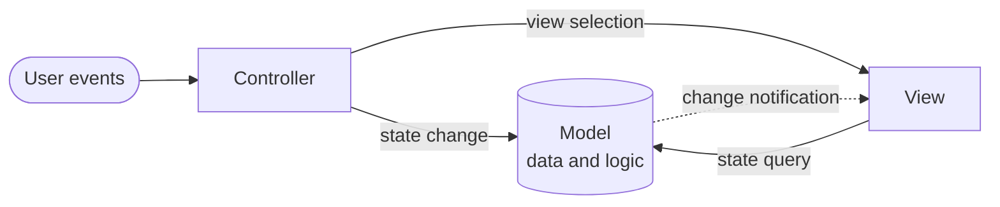
*Figure 16: The MVC pattern.*

**2. Layered architecture**

Organizes the system into layers. Each layer provides services to the layer above and relies on the layer below. The example below is the four-layer architecture of the iLearn digital learning system.

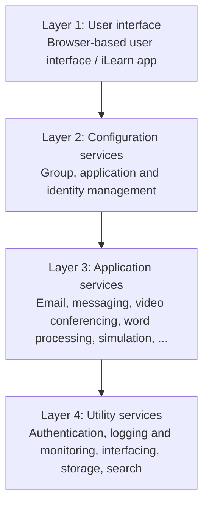
*Figure 17: Layered architecture of the iLearn system.*

**3. Repository architecture**

All shared data is held in a central repository, and components interact only through it. The example is an integrated development environment (IDE).

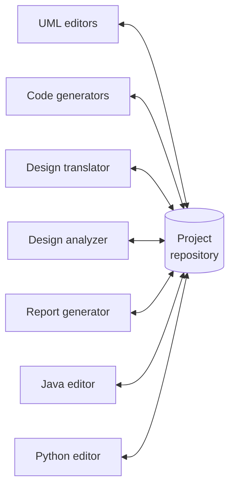
*Figure 18: A repository architecture for an IDE.*

**4. Client-server architecture**

The system is a set of services, each delivered by a separate server. Clients use these services. The example is a film and photo library.

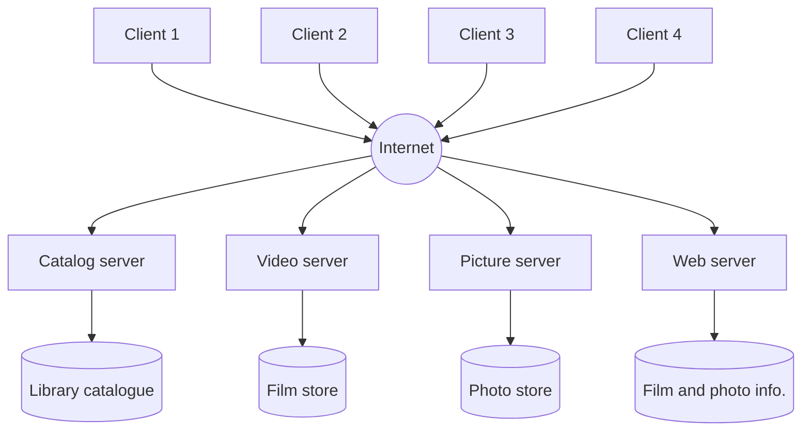
*Figure 19: A client-server architecture for a film library.*

**Comparison of the four patterns**

| Pattern | When Used | Advantages | Disadvantages |
|---|---|---|---|
| **MVC** | Many ways to view and interact with data, or future presentation needs are unknown | Data and its presentation can change independently; the same data can be shown in different ways | Can add extra code and complexity when the data model and interactions are simple |
| **Layered** | Building new features on top of existing systems; several teams each handle a layer; multilevel security needed | A whole layer can be replaced if its interface stays the same; supports incremental development | A clean separation between layers is hard; performance can suffer because requests pass through several layers |
| **Repository** | Large amounts of data stored for a long time; data-driven systems | Components are independent; data is managed consistently in one place | The repository is a single point of failure; routing all communication through it can be inefficient |
| **Client-server** | Shared data accessed from many locations; load varies | Servers can be distributed over a network; common services available to all clients | Each server is a single point of failure; performance depends on the network |

[Back to top](#table-of-contents)

---

## Q6. Object-Oriented Design and Implementation

| CO | Bloom's Level | Marks | Source |
|---|---|---|---|
| CO3 | Knowledge, Understanding | 4 | Chapter 7 |

### Question

**(a)** *(Knowledge, 2 marks)* What is an object-oriented system? List the activities of object-oriented design using the UML, the four essential elements of a design pattern, and the three implementation issues highlighted in the book.

**(b)** *(Understanding, 2 marks)* Using the wilderness weather station example, explain how use case, class, sequence and state models are developed. Explain the Observer pattern with a UML diagram.

### Answer

#### (a) Key concepts

An **object-oriented system** is made up of interacting objects that keep their own local state and provide operations on that state. The state is private and cannot be accessed directly from outside the object. Changing one object's implementation should not affect other objects, which improves understandability and maintainability.

**Activities of object-oriented design using the UML:**

```mermaid
flowchart LR
    A["1. Understand and define the<br/>context and external<br/>interactions"] --> B["2. Design the<br/>system architecture"] --> C["3. Identify the<br/>principal objects"] --> D["4. Develop<br/>design models"] --> E["5. Specify<br/>interfaces"]
```
*Figure 20: Activities of object-oriented design.*

Design is not a clear-cut, sequential process. Designers propose solutions, refine them as information becomes available, and often have to backtrack.

**Four essential elements of a design pattern:**

1. A **name** that is a meaningful reference to the pattern.
2. A **problem description** explaining when the pattern may be applied.
3. A **solution description** of the parts of the design, their relationships and responsibilities. It is a template, not a concrete design.
4. A statement of the **consequences**: the results and trade-offs of using the pattern.

**Three implementation issues:**

| Issue | Meaning |
|---|---|
| **Reuse** | Most modern software is built by reusing existing components or systems, so existing code should be used as much as possible. |
| **Configuration management** | Many versions of each component are created, and they must be tracked to avoid including the wrong versions in a system. |
| **Host-target development** | Software is developed on one computer (the host) but runs on another (the target), which may be completely different. |

#### (b) Designing the wilderness weather station

Wilderness weather stations are deployed in remote areas. They record local weather data and periodically send it to a weather information system through a satellite link.

**Step 1: System context and interactions**

The context model is a structural model showing the other systems in the environment. The interaction model is a dynamic model, often a use case model, showing how the system interacts with its environment. The environment of each weather station is a weather information system, an onboard satellite system and a control system. There is a single control system, but several weather stations.

```mermaid
flowchart LR
    CS["Control system"] --- WS["Weather station"]
    WIS["Weather information system"] --- WS
    SAT["Satellite"] --- WS
```
*Figure 21: System context of the weather station.*

```mermaid
flowchart LR
    WIS(["Actor:<br/>Weather information system"]) --> UC1(["Report weather"])
    WIS --> UC2(["Report status"])
    CS(["Actor:<br/>Control system"]) --> UC3(["Restart"])
    CS --> UC4(["Shutdown"])
    CS --> UC5(["Reconfigure"])
    CS --> UC6(["Powersave"])
    CS --> UC7(["Remote control"])
```
*Figure 22: Weather station use cases.*

**Step 2: Architectural design**

The system is organized as independent subsystems that communicate by sending messages over a common communication link.

```mermaid
flowchart TB
    subgraph LINK["Communication link"]
        direction LR
        FM["Fault manager"]
        CM["Configuration manager"]
        PM["Power manager"]
        CO["Communications"]
        DC["Data collection"]
        IN["Instruments"]
    end
```
*Figure 23: High-level architecture of the weather station (all subsystems use the communication link).*

**Step 3: Identify object classes**

Use case descriptions help identify objects. The book suggests three ways to find them: grammatical analysis of a natural language description (nouns become objects and attributes, verbs become operations), using tangible things in the application domain, and scenario-based analysis. In practice, several sources of knowledge are used together.

```mermaid
classDiagram
    class WeatherStation {
        +identifier
        +reportWeather()
        +reportStatus()
        +powerSave(instruments)
        +remoteControl(commands)
        +reconfigure(commands)
        +restart(instruments)
        +shutdown(instruments)
    }
    class WeatherData {
        +airTemperatures
        +groundTemperatures
        +windSpeeds
        +windDirections
        +pressures
        +rainfall
        +collect()
        +summarize()
    }
    class GroundThermometer {
        +gt_Ident
        +temperature
        +get()
        +test()
    }
    class Anemometer {
        +an_Ident
        +windSpeed
        +windDirection
        +get()
        +test()
    }
    class Barometer {
        +bar_Ident
        +pressure
        +height
        +get()
        +test()
    }
```
*Figure 24: Weather station objects.*

**Step 4: Design models**

The UML supports two kinds of design models: **structural models** (static structure: classes, inheritance, composition) and **dynamic models** (runtime interactions: service requests and state changes). Three model types are especially useful: subsystem models (structural), sequence models (dynamic) and state machine models (dynamic). Too much modeling should be avoided, because detailed implementation decisions are best left until the system is implemented.

*Sequence model:* this shows what happens when the weather information system requests a weather report. A stick arrowhead means the sender does not wait for a reply (asynchronous). A solid arrowhead means the sender waits (synchronous).

```mermaid
sequenceDiagram
    participant WIS as Weather information system
    participant SC as :SatComms
    participant WS as :WeatherStation
    participant CL as :Commslink
    participant WD as :WeatherData
    WIS-)SC: request(report)
    SC--)WIS: acknowledge
    SC-)WS: reportWeather()
    WS--)SC: acknowledge
    WS->>CL: get(summary)
    CL->>WD: summarize()
    WD-->>CL: weather summary
    CL-->>WS: weather summary
    WS-)SC: send(report)
    SC--)WS: acknowledge
    SC-)WIS: reply(report)
    WIS--)SC: acknowledge
```
*Figure 25: Sequence diagram for weather data collection.*

*State machine model:* this shows how the weather station changes state in response to service requests.

```mermaid
stateDiagram-v2
    [*] --> Shutdown
    Shutdown --> Running: restart()
    Shutdown --> Configuring: reconfigure() / powerSave()
    Configuring --> Running: configuration done
    Running --> Shutdown: shutdown()
    Running --> Controlled: remoteControl()
    Running --> Testing: reportStatus()
    Testing --> Transmitting: test complete
    Transmitting --> Running: transmission done
    Running --> Collecting: clock
    Collecting --> Running: collection done
    Running --> Summarizing: reportWeather()
    Summarizing --> Transmitting: weather summary complete
```
*Figure 26: State diagram of the weather station.*

**Step 5: Design pattern example, Observer**

The **Observer** pattern separates the display of an object's state from the object itself and allows several alternative displays. When the state changes, all displays are notified and updated. For example, the same data can be shown as both a pie chart and a bar chart.

- **Problem:** several display formats are needed, and the object holding the state should not need to know about them.
- **Solution:** two abstract classes (*Subject* and *Observer*) and two concrete classes (*ConcreteSubject* and *ConcreteObserver*). The subject holds the state and lets observers attach and detach. When the state changes, it notifies all observers, who update their copies.
- **Consequences:** coupling between the subject and observers is minimal. However, display optimizations are hard, and a change to the subject may trigger unnecessary updates.

```mermaid
classDiagram
    class Subject {
        <<abstract>>
        +Attach(Observer)
        +Detach(Observer)
        +Notify()
    }
    class Observer {
        <<abstract>>
        +Update()
    }
    class ConcreteSubject {
        -subjectState
        +GetState()
    }
    class ConcreteObserver {
        -observerState
        +Update()
    }
    Subject "1" o-- "*" Observer
    Subject <|-- ConcreteSubject
    Observer <|-- ConcreteObserver
    ConcreteObserver --> ConcreteSubject
```
*Figure 27: UML model of the Observer pattern.*

**Reuse at different levels:** Software can be reused at the *abstraction level* (design and architectural patterns), the *object level* (objects from a library), the *component level* (collections of objects), and the *system level* (reusing and configuring entire application systems).

[Back to top](#table-of-contents)

---

## Q7. Software Testing

| CO | Bloom's Level | Marks | Source |
|---|---|---|---|
| CO4 | Knowledge, Understanding | 4 | Chapter 8 |

### Question

**(a)** *(Knowledge, 2 marks)* What are the goals of software testing? Distinguish between validation testing and defect testing, and between verification and validation.

**(b)** *(Understanding, 2 marks)* Explain the three stages of testing for a commercial software system. Then describe test-driven development (TDD) and its benefits.

### Answer

#### (a) Goals of testing and V&V

**Testing** is meant to show that a program does what it is intended to do and to discover defects before the program is put into use. The program is executed with artificial data and the results are checked for errors or anomalies. Testing has two goals:

1. To show the developer and customer that the software **meets its requirements**. This is **validation testing**. The test cases reflect how the system is expected to be used.
2. To **find inputs where the software behaves incorrectly** or not according to its specification. This is **defect testing**. The test cases can be deliberately unusual.

```mermaid
flowchart LR
    subgraph IN["Input test data"]
        Ie["Ie: inputs causing<br/>anomalous behavior"]
    end
    SYS["System under test"]
    subgraph OUT["Output test results"]
        Oe["Oe: outputs revealing<br/>the presence of defects"]
    end
    IN --> SYS --> OUT
```
*Figure 28: An input-output model of program testing.*

An important limit of testing is that it can only show that errors are present. It cannot show that there are none.

Testing is part of the broader process of **verification and validation (V&V)**:

| | Question it Asks | Meaning |
|---|---|---|
| **Verification** | "Are we building the product right?" | Checks that the software meets its stated functional and non-functional requirements. |
| **Validation** | "Are we building the right product?" | A more general check that the software meets the customer's real expectations. |

The goal of V&V is to build confidence that the system is "fit for purpose". The confidence needed depends on how critical the software is, what users expect, and the current marketing environment.

#### (b) Stages of testing and test-driven development

**Three stages of testing**

```mermaid
flowchart LR
    subgraph DT["1. Development testing (developers)"]
        direction LR
        UT["Unit<br/>testing"] --> CT["Component<br/>testing"] --> ST["System<br/>testing"]
    end
    subgraph RT["2. Release testing (separate team)"]
        RL["Test a complete<br/>release"]
    end
    subgraph UTG["3. User testing (users)"]
        direction LR
        AL["Alpha<br/>testing"] --> BT["Beta<br/>testing"] --> AC["Acceptance<br/>testing"]
    end
    DT --> RT --> UTG
```
*Figure 29: The three stages of testing.*

| Stage | Who Tests | Purpose | Details |
|---|---|---|---|
| **1. Development testing** | The development team | Discover bugs and defects during development | **Unit testing** (individual methods or classes), **component testing** (units combined, focusing on component interfaces), and **system testing** (components integrated, focusing on their interactions). |
| **2. Release testing** | A separate testing team | Check that a complete release meets requirements and is good enough for use | Usually *black-box* testing, where tests come from the specification. It is a validation check. |
| **3. User testing** | Users or customers in their own environment | Check suitability in real working conditions, which developers cannot fully reproduce | **Alpha testing** (selected users work with developers on early releases), **beta testing** (a larger group tries a release and reports problems) and **acceptance testing** (the customer decides whether to accept the system). |

Testing usually mixes manual and automated methods. Automated tests are especially useful for *regression testing*, which means re-running earlier tests to check that new changes have not introduced new bugs.

**Acceptance testing** follows a defined process:

```mermaid
flowchart LR
    A["Define acceptance<br/>criteria"] --> B["Plan acceptance<br/>testing"] --> C["Derive acceptance<br/>tests"] --> D["Run acceptance<br/>tests"] --> E["Negotiate<br/>test results"] --> F{"Accept or<br/>reject system"}
```
*Figure 30: The acceptance testing process.*

**Test-driven development (TDD)**

TDD is an approach in which testing and code development are interleaved. Code is developed in small increments along with its tests, and the next increment is not started until the current code passes all its tests. It began as part of Extreme Programming but can be used in both agile and plan-based processes.

```mermaid
flowchart TD
    A["1. Identify new<br/>functionality"] --> B["2. Write test and<br/>implement as automated test"]
    B --> C["3. Run test<br/>(it should fail at first)"]
    C --> D["4. Implement functionality<br/>and refactor if needed"]
    D --> E{"5. All tests<br/>pass?"}
    E -- "No" --> D
    E -- "Yes" --> A
```
*Figure 31: The test-driven development cycle.*

**Benefits of TDD:**

- **Code coverage:** every piece of code has at least one test, so defects are found early.
- **Regression testing:** the test suite grows with the program and can be re-run at any time.
- **Simpler debugging:** when a test fails, the problem is most likely in the newly written code.
- **System documentation:** the tests describe what the code is supposed to do.

**Limitations:** TDD works best for new development. It is hard to use when large existing components or legacy systems are reused, and it can be ineffective for multithreaded systems. A separate system testing process is still needed to check that the system meets all stakeholder requirements.

[Back to top](#table-of-contents)

---

## Q8. Software Evolution and Maintenance

| CO | Bloom's Level | Marks | Source |
|---|---|---|---|
| CO4 | Knowledge, Understanding | 4 | Chapter 9 |

### Question

**(a)** *(Knowledge, 2 marks)* What is software maintenance? Name the three types of maintenance and the four strategic options for managing a legacy system.

**(b)** *(Understanding, 2 marks)* Explain the software evolution process, including emergency repairs. Explain why maintenance costs more than initial development and how legacy systems are assessed.

### Answer

#### (a) Maintenance types and legacy options

**Software maintenance** is the general process of changing a system after it has been delivered. The changes may be simple (correcting coding errors), more extensive (correcting design errors), or significant (accommodating new requirements).

**Three types of maintenance:**

1. **Fault repairs:** fixing bugs and vulnerabilities. Coding errors are cheap to fix, design errors cost more, and requirements errors are the most expensive.
2. **Environmental adaptation:** adapting the software to new platforms and environments, such as new hardware or a new operating system.
3. **Functionality addition:** adding new features to support new requirements, usually when the business changes.

```mermaid
pie showData
    title Maintenance effort distribution (%)
    "Functionality addition or modification" : 58
    "Fault repair" : 24
    "Environmental adaptation" : 19
```
*Figure 32: Approximate distribution of maintenance effort (the book's percentages add to 101 because of rounding).*

Most maintenance effort goes into adding and changing functionality, not into repairing faults.

**Legacy systems** are older systems that rely on languages and technology no longer used for new development. They are broader sociotechnical systems that include hardware, support software, application software, application data and business processes.

**Four strategic options for a legacy system:**

1. Scrap the system completely.
2. Leave the system unchanged and continue with regular maintenance.
3. Reengineer the system to improve its maintainability.
4. Replace all or part of the system with a new system.

#### (b) Evolution process, maintenance cost and legacy assessment

**The evolution process**

Change proposals drive evolution. They may come from unimplemented requirements, new requirements, bug reports and new ideas from the development team. Change identification and system evolution are cyclical and continue throughout the lifetime of the system.

```mermaid
flowchart LR
    CI["Change identification<br/>process"] -- "change proposals" --> SE["Software evolution<br/>process"]
    SE -- "new system" --> CI
```
*Figure 33: Change identification and evolution processes.*

```mermaid
flowchart LR
    CR["Change<br/>requests"] --> IA["Impact<br/>analysis"] --> RP["Release<br/>planning"] --> CI["Change<br/>implementation"] --> SR["System<br/>release"]
    RP --> FR["Fault repair"]
    RP --> PA["Platform adaptation"]
    RP --> SEN["System enhancement"]
    FR --> CI
    PA --> CI
    SEN --> CI
```
*Figure 34: A general model of the software evolution process.*

Before a change is accepted, an analysis works out which components are affected and what the cost and impact will be. During release planning, fault repairs, adaptations and new functionality are all considered. If a different team does the work, the first step of implementation is *program understanding*.

**Emergency repairs**

Some changes must be made urgently: a serious fault or security vulnerability, an unexpected effect of an environment change, or a sudden business change such as new legislation. In these cases the code is fixed first and requirements and design are not updated.

```mermaid
flowchart LR
    A["Change<br/>requests"] --> B["Analyze<br/>source code"] --> C["Modify<br/>source code"] --> D["Deliver<br/>modified system"]
```
*Figure 35: The emergency repair process.*

The danger is that requirements, design and code become inconsistent, and software ageing accelerates, so future changes become harder. Ideally, the emergency code should be refactored afterwards.

**Why maintenance costs more than initial development**

1. A new team has to understand the program first, because the original team has usually moved on.
2. Maintenance and development are often separate contracts, so developers have no incentive to write maintainable software.
3. Maintenance work is unpopular and is often given to the least experienced staff.
4. As programs age, their structure degrades and they become harder to change.

**Assessing legacy systems**

A legacy system is assessed from a business perspective (does the business really need it?) and a technical perspective (quality of the software, support software and hardware). Combining **business value** and **system quality** gives four clusters:

```mermaid
quadrantChart
    title Legacy system assessment
    x-axis Low quality --> High quality
    y-axis Low business value --> High business value
    quadrant-1 Keep operating and maintain normally
    quadrant-2 Reengineer or replace
    quadrant-3 Scrap
    quadrant-4 Maintain normally, scrap if changes are costly
```
*Figure 36: Legacy system assessment by business value and system quality.*

| Cluster | Recommended Action |
|---|---|
| Low quality, low business value | Scrap the system. It is expensive to keep and gives little return. |
| Low quality, high business value | Reengineer to improve quality, or replace if a suitable off-the-shelf system exists. |
| High quality, low business value | Continue normal maintenance. Scrap if expensive changes become necessary. |
| High quality, high business value | Keep in operation with normal maintenance. |

**Refactoring vs. reengineering:** *Refactoring* is continuous improvement of a program's structure, without adding functionality, to slow down degradation. It is a kind of preventative maintenance and is a natural part of agile methods. *Reengineering* happens after a system has been maintained for some time and maintenance costs are rising. Automated tools are used to turn a legacy system into a more maintainable one.

[Back to top](#table-of-contents)

---

## Q9. Quality Management

| CO | Bloom's Level | Marks | Source |
|---|---|---|---|
| CO5 | Knowledge, Understanding | 4 | Chapter 24 |

### Question

**(a)** *(Knowledge, 2 marks)* What is software quality? Name some software quality attributes, and state why standards are important and what the two types of standard are.

**(b)** *(Understanding, 2 marks)* Explain the process-based approach to quality, the software review process, and the use of software metrics.

### Answer

#### (a) Software quality and standards

Software quality cannot be compared directly with quality in manufacturing, where a product is checked against a detailed specification within a tolerance. For software, it is hard to write complete and unambiguous requirements, specifications are compromises between several stakeholder groups, and some quality characteristics (such as maintainability) cannot be measured directly. Because of this, assessing software quality is a **subjective process**. The quality management team uses its judgment to decide whether the software is fit for its intended purpose.

Quality depends on non-functional attributes as well as functionality. Users can often work around missing functionality, but not around software that is unreliable or too slow. No system can be optimized for all attributes, so the quality plan should define the most important ones for the project.

| Group | Example Quality Attributes |
|---|---|
| Dependability | Safety, security, reliability, resilience, robustness |
| Maintainability | Understandability, testability, adaptability, modularity, complexity |
| Usability and efficiency | Usability, learnability, efficiency, portability, reusability |

**Why software standards are important:**

1. They capture wisdom that is valuable to the organization and help avoid repeating past mistakes.
2. They provide a framework for defining what quality means in a particular setting.
3. They help continuity when work passes from one person to another, because everyone follows the same practices.

**Two types of standard:**

| Type | Applies to | Examples |
|---|---|---|
| **Product standards** | The software product | Requirements document structure, method header format, Java programming style |
| **Process standards** | How software is developed | Design review conduct, version release process, change control process |

#### (b) Process-based quality, reviews and metrics

**Process-based quality**

Traditional quality management assumes that product quality is related to the quality of the development process. The process is defined, the product is developed and its quality is assessed. If quality is not acceptable, the process is improved. If it is acceptable, the process is standardized.

```mermaid
flowchart LR
    A["Define<br/>process"] --> B["Develop<br/>product"] --> C["Assess product<br/>quality"] --> D{"Quality<br/>OK?"}
    D -- "No" --> E["Improve<br/>process"] --> B
    D -- "Yes" --> F["Standardize<br/>process"]
```
*Figure 37: Process-based quality assurance.*

This link is weaker for software than for manufacturing, because software is designed rather than manufactured. Individual skill, the novelty of the application and commercial pressure all affect quality, and too much standardization can limit creativity. Good processes help, but managers should also build a **quality culture** where everyone is committed to high quality. In agile development, quality management is informal and based on shared good practice, such as checking code with team members before check-in, refactoring and test-driven development.

**Reviews and inspections**

Reviews and inspections check project deliverables (specifications, designs, code, test plans and so on) for errors, omissions and violations of standards. They are used alongside testing as part of verification and validation. Their purpose is to improve software quality, not to judge the people on the team. The review process has three phases:

```mermaid
flowchart LR
    subgraph PRE["Pre-review activities"]
        direction TB
        P1["Planning"] --> P2["Group<br/>preparation"] --> P3["Individual<br/>preparation"]
    end
    RM["Review<br/>meeting"]
    subgraph POST["Post-review activities"]
        direction TB
        Q1["Error<br/>correction"] --> Q2["Follow-up<br/>checks"] --> Q3["Improvement"]
    end
    PRE --> RM --> POST
```
*Figure 38: The software review process.*

- **Pre-review:** set up the review team, arrange the meeting, distribute documents, and let reviewers study them independently.
- **Review meeting:** the author walks through the document with the team. It should last two hours at most, with a chair and a person who records decisions and actions.
- **Post-review:** the problems raised are fixed (bugs, refactoring or rewriting documents). The chair checks that all comments were handled, and a further review may be needed.

**Software metrics**

A **software metric** is a characteristic of a system, its documentation or its development process that can be measured objectively, for example size in lines of code, the number of reported faults, or the effort needed to repair a defect.

```mermaid
flowchart LR
    SP["Software process"] -- "control metric<br/>measurements" --> MD["Management<br/>decisions"]
    PR["Software product"] -- "predictor metric<br/>measurements" --> MD
```
*Figure 39: Predictor and control measurements.*

- **Control metrics** support process management, for example the average effort and time to repair reported defects.
- **Predictor metrics** help predict characteristics of the software product.

Measuring a baseline before and after introducing a new tool, such as a testing tool, shows whether the tool helps.

[Back to top](#table-of-contents)

---

## Q10. Configuration Management

| CO | Bloom's Level | Marks | Source |
|---|---|---|---|
| CO5 | Knowledge, Understanding | 4 | Chapter 25 |

### Question

**(a)** *(Knowledge, 2 marks)* What is configuration management and why is it needed? Name its four main activities.

**(b)** *(Understanding, 2 marks)* Explain version management (codelines and baselines), system building, change management and release management.

### Answer

#### (a) Configuration management and its activities

**Configuration management (CM)** is concerned with the policies, processes and tools for managing changing software systems. It is needed because it is easy to lose track of which changes and component versions are in each system version. Several versions may be under development and in use at the same time. Without CM, effort may be wasted modifying the wrong version, the wrong version may be delivered to a customer, or the source code for a version may be lost. CM is useful for individual projects and essential for team projects, including distributed teams. Agile development, where code changes several times a day, is impossible without CM tools.

**Four closely related activities:**

1. **Version control:** keeping track of the multiple versions of system components and ensuring that changes by different developers do not interfere.
2. **System building:** assembling program components, data and libraries, then compiling and linking them to create an executable system.
3. **Change management:** keeping track of change requests, working out their cost and impact, and deciding if and when to implement them.
4. **Release management:** preparing software for external release and keeping track of released versions.

```mermaid
flowchart LR
    CP(["Change<br/>proposals"]) --> CM["Change<br/>management"]
    CV(["Component<br/>versions"]) --> VM["Version<br/>management"]
    VM --> SB["System<br/>building"]
    SB --> SV(["System<br/>versions"])
    SV --> RM["Release<br/>management"]
    RM --> SR(["System<br/>releases"])
    CM --> VM
```
*Figure 40: Configuration management activities.*

#### (b) The CM activities explained

**1. Version management**

Version management keeps track of different versions of components and the systems that use them, and ensures changes by different developers do not interfere.

- A **codeline** is a sequence of versions of a source code component, with later versions derived from earlier ones.
- A **baseline** is a definition of a specific system. It lists the component versions to include, plus the libraries and configuration files used. Baselines let you re-create a particular system version, for example the version delivered to a customer who reports a bug.
- The **mainline** is the sequence of system versions developed from an original baseline.

```mermaid
flowchart LR
    subgraph CLA["Codeline A"]
        direction LR
        A0["A"] --> A11["A1.1"] --> A12["A1.2"] --> A13["A1.3"]
    end
    subgraph CLB["Codeline B"]
        direction LR
        B0["B"] --> B11["B1.1"] --> B12["B1.2"] --> B13["B1.3"]
    end
    subgraph CLC["Codeline C"]
        direction LR
        C0["C"] --> C11["C1.1"] --> C12["C1.2"] --> C13["C1.3"]
    end
    V1(["Baseline V1"]) -. "A" .-> A0
    V1 -. "B1.2" .-> B12
    V1 -. "C1.1" .-> C11
    V2(["Baseline V2"]) -. "A1.3" .-> A13
    V2 -. "B1.2" .-> B12
    V2 -. "C1.2" .-> C12
```
*Figure 41: Codelines and baselines. Each baseline (V1, V2) points to specific component versions. A baseline also lists the libraries and external components used, which are left out here for clarity.*

There are two types of version control system: **centralized** (one master repository, for example Subversion) and **distributed** (multiple repositories, for example Git). Key features include version and release identification, change history recording, independent development, project support and storage management.

**2. System building**

System building creates a complete executable system by compiling and linking components, libraries, configuration files and other information. An automated build tool should be used so that a complete system can be built with a single command.

```mermaid
flowchart LR
    SRC["Source code files"] --> BS
    DATA["Data files"] --> BS
    LIB["Libraries"] --> BS
    CFG["Configuration files"] --> BS
    CMP["Compilers and tools"] --> BS
    BS["Automated<br/>build system"] --> TS["Executable<br/>target system"]
    BS --> ET["Executable<br/>tests"]
    ET --> TR(["Test results"])
```
*Figure 42: The system building process.*

Build tools typically provide build script generation, version control integration, minimal recompilation, executable system creation, test automation and reporting.

**3. Change management**

Change management ensures that changes are applied in a controlled way and that the most urgent and cost-effective changes are prioritized. It analyzes the costs and benefits of proposed changes, approves the cost-effective ones, and tracks which components were changed.

```mermaid
flowchart TD
    A(["Customer:<br/>Submit CR"]) --> B["Check CR"]
    B --> C{"Valid?"}
    C -- "Invalid" --> D["Close CR"]
    C -- "Valid" --> E["Register CR"]
    E --> F["Implementation<br/>analysis"]
    F --> G["Cost and impact<br/>analysis"]
    G --> H["Assess CRs<br/>(change control board)"]
    H --> I["Select CRs"]
    I --> J["Modify software"]
    J --> K["Test software"]
    K --> L{"Test result"}
    L -- "Fail" --> J
    L -- "Pass" --> M["Close CR"]
```
*Figure 43: The change management process (CR = change request).*

All change management processes should include a way of checking, costing and approving changes. Tools range from simple issue and bug trackers to systems integrated with a full CM package.

**4. Release management**

A **system release** is a version of the software distributed to customers. Mass-market software usually has **major releases**, which add significant functionality (customers usually pay for them), and **minor releases**, which fix bugs and customer problems (usually free). A release is more than executable code. It may also include configuration files, data files, an installation program, documentation and packaging.

Release creation involves tagging the code and data files with a release identifier in the version control system, writing configuration descriptions and installation scripts for different platforms, preparing customer instructions, and making the release available (for example on a web page). Release timing needs care. If releases are too frequent, customers may not upgrade. If they are too rare, market share may be lost.

[Back to top](#table-of-contents)

---

## 5. References

1. Sommerville, I. (2016). *Software Engineering* (10th ed., Global Edition). Pearson Education Limited. ISBN 978-1-292-09613-1.

**Chapters used from the book**

| Question | Chapter |
|---|---|
| Q1 | Chapter 2: Software Processes |
| Q2 | Chapter 3: Agile Software Development |
| Q3 | Chapter 4: Requirements Engineering |
| Q4 | Chapter 5: System Modeling |
| Q5 | Chapter 6: Architectural Design |
| Q6 | Chapter 7: Design and Implementation |
| Q7 | Chapter 8: Software Testing |
| Q8 | Chapter 9: Software Evolution |
| Q9 | Chapter 24: Quality Management |
| Q10 | Chapter 25: Configuration Management |

---

<div align="center">

*This README was prepared as an academic assignment. All content is based on the referenced textbook.*

[Back to top](#table-of-contents)

</div>
